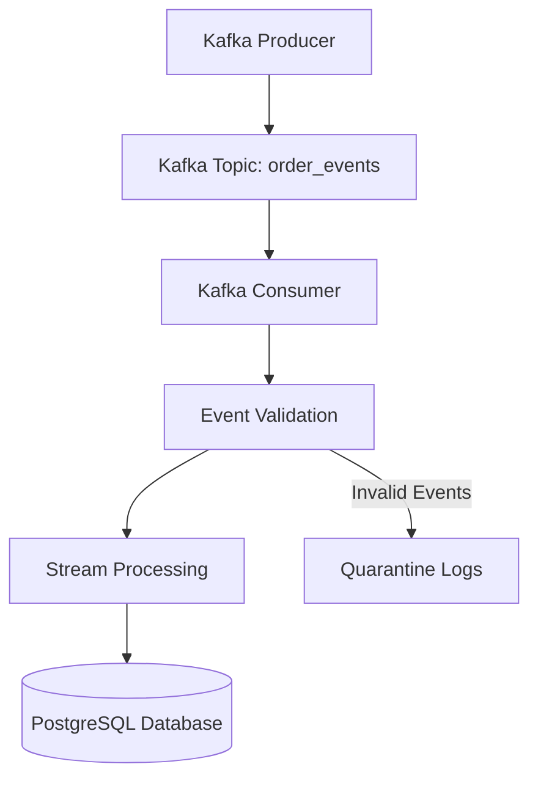

# E-Commerce Data Engineering Pipeline

A Python-based data engineering project that demonstrates an e-commerce event pipeline using Apache Kafka and PostgreSQL, with data validation, processing, duplicate handling, logging, and automated tests.

## Architecture



## Tech Stack

- **Python** — event generation, validation, and processing
- **Apache Kafka** — event streaming and messaging
- **PostgreSQL** — structured event storage
- **Docker Compose** — Kafka environment
- **pytest** — automated testing
- **Git & GitHub** — version control

## Key Features

- Generates and publishes e-commerce order events.
- Consumes events from the Kafka `order_events` topic.
- Validates incoming event data.
- Processes valid events and stores them in PostgreSQL.
- Handles duplicate events.
- Records invalid events for quarantine and investigation.
- Uses application logging for troubleshooting.
- Includes automated tests for core functionality.

## Project Structure

```text
E-Commerce/
├── app/
│   ├── config.py
│   ├── db.py
│   ├── event_generator.py
│   ├── kafka_consumer.py
│   ├── kafka_producer.py
│   ├── logger.py
│   ├── processor.py
│   ├── stream_processor.py
│   └── validator.py
├── scripts/
├── tests/
├── docker-compose.yml
├── main.py
├── .gitignore
└── README.md
```

## Prerequisites

- Python 3.11 or a compatible version
- Docker Desktop
- PostgreSQL
- Git

## Setup

### 1. Clone the repository

```bash
git clone https://github.com/Kaustav-78/E-Commerce-Data-Engineering.git
cd E-Commerce-Data-Engineering
```

### 2. Create and activate a virtual environment

**Windows PowerShell:**

```powershell
python -m venv .venv
.\.venv\Scripts\Activate.ps1
```

### 3. Install dependencies

Install the project dependencies used by the application and tests:

```powershell
python -m pip install kafka-python "psycopg[binary]" python-dotenv pytest
```

### 4. Configure environment variables

Create a local `.env` file in the project root. Configure the PostgreSQL connection settings expected by `app/config.py` and `app/db.py`, including the database name, username, password, host, and port.

**Security:** Never commit `.env` or expose database passwords in source code.

### 5. Start Kafka

Start Docker Desktop, then run:

```powershell
docker compose up -d
```

Confirm that the Kafka container is running before starting the producer and consumer.

### 6. Run the consumer

Open a terminal in the project root:

```powershell
python -m app.kafka_consumer
```

Keep this terminal running.

### 7. Publish events

Open a second terminal, activate the virtual environment, and run:

```powershell
python -m app.kafka_producer
```

The producer publishes an event to Kafka, and the consumer processes it for storage in PostgreSQL.

> Ensure PostgreSQL is running, the database and required table exist, and the environment variables are configured correctly before running the pipeline.

## Run Tests

From the project root:
## Testing and Verification

### Automated Tests

Run the test suite from the project root:

```powershell
python -m pytest -v
```

**Latest test result:** 12 tests passed.

The test suite covers:

- Database insertion and duplicate-event handling
- Database connection failure propagation
- Event generation
- Deduplication and invalid-event quarantine
- Input validation, including missing fields, negative quantities, and zero prices

### Live Kafka-to-PostgreSQL Verification

The streaming pipeline was manually verified in the development environment.

1. Started the Kafka container using Docker.
2. Started the PostgreSQL service.
3. Ran the Kafka consumer.
4. Published an event to the `order_events` topic.
5. Confirmed that the consumer processed the event and reported `result=inserted`.
6. Queried PostgreSQL directly to verify the stored record.

**Verified sample event:**

| Field | Value |
|---|---|
| Event ID | `kafka-test-003` |
| Order ID | `ORD-KAFKA-003` |
| Customer ID | `CUST0001` |
| Product ID | `P101` |
| Quantity | 2 |
| Unit price | 499.00 |
| Total amount | 998.00 |

The database query returned the expected record, confirming that the event was persisted and its total amount was calculated correctly.

> These results reflect the tests and manual integration checks performed in the development environment. They are not a claim of production-scale load or resilience testing.

## Data Flow

1. The producer generates an e-commerce event.
2. Kafka receives the event in the `order_events` topic.
3. The consumer reads the event.
4. The application validates and processes the event.
5. Valid events are inserted into PostgreSQL.
6. Duplicate events are handled by the processing logic.
7. Invalid events are recorded for quarantine and troubleshooting.

## Future Improvements

- Add a reproducible database initialization script.
- Add a dependency file such as `requirements.txt`.
- Add structured metrics and monitoring.
- Introduce automated integration tests for Kafka and PostgreSQL.
- Add CI/CD workflows and deployment documentation.

## Author

**Kaustav Sengupta**

GitHub: [Kaustav-78](https://github.com/Kaustav-78)
