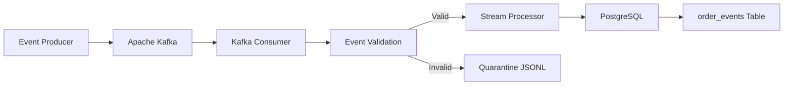

# E-Commerce Data Engineering Pipeline

A Python-based e-commerce data engineering project that demonstrates event streaming, data validation, duplicate handling, and loading events into PostgreSQL using Apache Kafka.

## Overview

This project implements a streaming pipeline for processing e-commerce order events. Events are published to Kafka, consumed by a Python consumer, validated, and loaded into PostgreSQL. Invalid events are recorded in a quarantine file for investigation.

## Architecture



## Technology Stack

- **Python** — event generation, processing, and validation
- **Apache Kafka** — event streaming and message transport
- **PostgreSQL** — persistent storage for order events
- **Docker Compose** — Kafka container setup
- **pytest** — automated testing
- **Git and GitHub** — version control and project hosting

## Key Features

- Kafka producer and consumer implementation
- JSON event serialization and deserialization
- Order event validation
- Calculation of total order amount
- Duplicate event handling
- Invalid event quarantine with error details
- PostgreSQL database integration
- Manual Kafka offset commits after event handling
- Logging and automated tests

## Project Structure

```text
E-Commerce-Data-Engineering/
├── app/
│   ├── config.py
│   ├── db.py
│   ├── event_generator.py
│   ├── kafka_consumer.py
│   ├── kafka_producer.py
│   ├── logger.py
│   ├── processor.py
│   ├── stream_processor.py
│   └── validator.py
├── data/
├── logs/
├── scripts/
│   ├── run_pipeline.py
│   └── test_logger.py
├── tests/
├── .gitignore
├── docker-compose.yml
└── main.py
```

## Prerequisites

- Python
- Docker Desktop with Docker Compose
- PostgreSQL running locally or at a configured database host
- A PostgreSQL database and the required `order_events` table
- Git

## Setup

### 1. Clone the repository

```bash
git clone https://github.com/Kaustav-78/E-Commerce-Data-Engineering.git
cd E-Commerce-Data-Engineering
```

### 2. Create a virtual environment

```bash
python -m venv .venv
```

Activate it on Windows PowerShell:

```powershell
.\.venv\Scripts\Activate.ps1
```

### 3. Install dependencies

```bash
python -m pip install kafka-python "psycopg[binary]" python-dotenv pytest
```

### 4. Configure environment variables

Create a local `.env` file in the project root:

```dotenv
DB_HOST=127.0.0.1
DB_PORT=5432
DB_NAME=ecommerce_db
DB_USER=postgres
DB_PASSWORD=your_local_database_password
```

Replace the example password with your local PostgreSQL password. Never commit `.env` or publish real credentials.

### 5. Start Kafka

```bash
docker compose up -d kafka
```

Verify the running containers:

```bash
docker ps
```

### 6. Run the producer

In one terminal:

```bash
python -m app.kafka_producer
```

The producer publishes a sample event to the `order_events` Kafka topic.

### 7. Run the consumer

In another terminal:

```bash
python -m app.kafka_consumer
```

The consumer reads Kafka events, validates them, and passes them to the stream processor for database insertion or invalid-event quarantine.

**Important:** Ensure PostgreSQL is running, the database and table are initialized, and the environment variables are configured before running the complete pipeline. The consumer may replay older messages when using a new consumer group.

## Testing

Run the automated test suite:

```bash
python -m pytest -v
```

## Data Flow

1. The producer publishes an order event to Kafka.
2. The consumer reads the event from the `order_events` topic.
3. The stream processor validates the event.
4. Valid events have their `total_amount` calculated and are sent to PostgreSQL.
5. Invalid events are written to a quarantine JSONL file with error details.
6. Handled events are committed by the consumer; processing failures are logged.

## Engineering Considerations

- **Validation:** rejects malformed or invalid order events.
- **Duplicate handling:** prevents duplicate event IDs from being inserted, subject to the database insert logic and constraints.
- **Error handling:** records invalid events for investigation and logs processing failures.
- **Offset management:** commits Kafka offsets only after the event handler returns an accepted result.
- **Configuration:** database credentials are loaded through environment variables.

## Current Validation

During local development:

- Kafka broker and `order_events` topic were verified.
- PostgreSQL connectivity and the `order_events` table were verified.
- A sample event was confirmed in PostgreSQL through the consumer's success log.
- The existing automated test suite reported 12 passing tests.

These checks describe the tested local setup; they do not imply production deployment or production-scale performance.

## Future Improvements

- Add a dependency lock file or `requirements.txt`.
- Add a PostgreSQL service and database initialization scripts to Docker Compose.
- Add CI using GitHub Actions.
- Add structured metrics and pipeline monitoring.
- Add integration tests for Kafka-to-PostgreSQL processing.
- Document recovery and retry policies.

## Author

**Kaustav Sengupta**

GitHub: [Kaustav-78](https://github.com/Kaustav-78)
